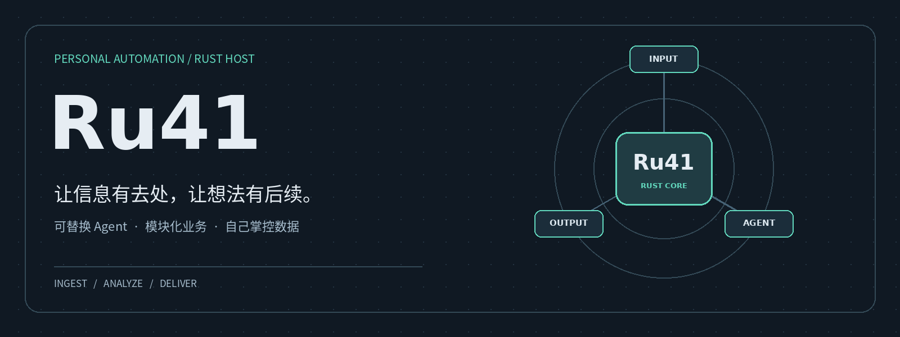

<div align="center">



# Ru41

**连接你的信息、Agent 与日常工作。**

Rust 编写的个人自动化宿主，接入 Codex / Pi，串联消息、信息来源与持久化任务。

[](https://github.com/windy664/Ru41/actions/workflows/ci.yml)


[功能](#能做什么) · [快速开始](#快速开始) · [架构](#如何运转) · [部署与配置](docs/usage.md) · [开发指南](docs/module-development.md)

</div>

## 为什么做 Ru41

个人想法散落在聊天和笔记中，论文与订阅源不断更新，宿舍水电也需要定期查看。Ru41 希望把这些日常需求接到同一个可持续运行的系统里：采集信息、交给 Agent 分析、保存结果，再送到你使用的渠道。

**Ru41 负责宿主，Codex / Pi 负责 Agent。** 任务调度、数据库、脱敏、事件和消息渠道由 Rust 管理；底座通过统一接口接入，业务模块可以独立扩展。

> **开发中 · v0.2**
>
> 已实现任务执行、QQ / 飞书通知、论文 / RSS、水电、私人待办与 Obsidian Vault 闭环（Git 轮询 → Agent 归档 → 提交推送）。Codex 任务以 yolo 模式执行，只应部署在隔离环境中。[查看实现边界 →](docs/core-status.md)

## 能做什么

| 日常场景 | Ru41 当前提供 | 接入说明 |
| :--- | :--- | :--- |
| **在聊天里发起任务** | QQ 群 @ / 单聊入队、查询与取消、结果回复 | [QQ 网关](docs/channels-qq.md) |
| **接收处理结果** | 飞书群 webhook 推送，或通过 QQ 回复原会话 | [飞书通知](docs/channels-feishu.md) |
| **追踪研究进展** | arXiv 分类订阅、关键词筛选、摘要与单篇精读 | [论文追踪](docs/sources-arxiv.md) |
| **整理订阅信息** | RSS / Atom 采集、去重与个人兴趣摘要 | [信息流](docs/sources-rss.md) |
| **用 YouTube 学英语** | 频道新视频字幕转写、重点词句预习单、带链接推送 | [YouTube 预习](docs/sources-youtube.md) |
| **关注宿舍水电** | 校园卡平台余额查询、历史读数、低余额提醒 | [水电监控](docs/ecard-waterfee.md) |
| **盯紧课程表** | 教务系统拉课表、调课停课提醒、明日课表推送、QQ 查课 | [课表监控](docs/sources-jwxt.md) |
| **管理私人待办** | 今日、近期、长期、逾期视图，QQ 单聊命令与 CLI | [使用说明](docs/usage.md#私人待办) |
| **搭建自己的自动化** | HTTP API、持久化事件、SSE 与可靠事件消费者 | [事件](docs/events.md) · [消费者](docs/event-consumers.md) |

各来源模块按需配置；采集、Worker 与通知进程分别运行。水电模块需要对应平台与房间参数，并非通用的任意学校查询服务。

## 快速开始

### 1. 准备环境

安装支持 **Rust 2024 edition** 的工具链，以及已完成认证的 **Codex CLI**。首次运行使用默认 SQLite；Pi 可在后续配置中启用。

```bash
git clone https://github.com/windy664/Ru41.git
cd Ru41
cargo build --locked
cargo run --locked -- init --non-interactive
cargo run --locked -- doctor
cargo run --locked -- backends
```

`init` 幂等创建最小配置、数据目录和数据库，不覆盖已有配置，也不接收密钥。`doctor` 默认只做离线检查；`doctor --deep` 才会连接数据库并真实调用模型。`backends` 查看已注册底座。

常用运维命令：

```bash
cargo run --locked -- config check  # 配置与供应商装配校验
cargo run --locked -- status        # 任务计数与启用组件
cargo run --locked -- dump          # 脱敏排障报告
cargo run --locked -- qq onboard    # 官方扫码创建/绑定机器人并写入凭证
cargo run --locked -- qq doctor     # QQ 凭证与 gateway，不发消息
```

### 2. 创建并执行任务

```bash
cargo run --locked -- task add \
  --key demo:1 \
  --backend codex \
  --prompt "给个人论文阅读计划列出三个建议"

cargo run --locked -- worker --once
cargo run --locked -- task list
```

查看详情时，将 `<任务ID>` 替换为返回的 ID：

```bash
cargo run --locked -- task show <任务ID>
cargo run --locked -- task attempts <任务ID>
```

Worker 会真实调用 Agent 并消耗对应额度。`--once` 最多领取一个就绪任务；需要持续处理时运行 `cargo run --locked -- worker`。

### 3. 连接你的日常入口

| 下一步 | 从哪里开始 |
| :--- | :--- |
| 使用 QQ 发起任务 | [创建机器人并启动网关](docs/channels-qq.md) |
| 订阅论文或 RSS | [arXiv 配置](docs/sources-arxiv.md) · [RSS 配置](docs/sources-rss.md) |
| 推送到飞书 | [配置 webhook 与通知进程](docs/channels-feishu.md) |
| 部署到宿舍服务器 | [Docker / Compose 部署](deploy/README.md) |

[完整操作手册：常驻运行、取消、重试与部署 →](docs/usage.md)

## 如何运转


<sub>任务流程示意，不是实时监控 · <a href="docs/assets/task-flow.png">静态版本</a></sub>

| 宿主能力 | 设计方式 |
| :--- | :--- |
| **Agent 可替换** | `AgentBackend` 统一边界；按任务底座路由，当前实现 Codex 与可选 Pi |
| **存储可替换** | 存储接口隔离业务与数据库，支持 SQLite / PostgreSQL |
| **执行可追踪** | 持久化任务、运行与尝试记录，支持租约、退避重试和取消 |
| **隐私边界** | 调用前替换为随机同类假值，输出回填；映射只留宿主内存 |
| **交互可转发** | 底座触发审批或补充信息请求，宿主持久化并通过 HTTP API 接收回复 |
| **状态可订阅** | 持久化事件、可续传 SSE，以及带确认与重试的消费者 |

<details>
<summary><strong>展开核心架构图与职责边界</strong></summary>


**Task** 表达工作目标，**AgentRun** 表达一次底座运行，**Interaction** 表达底座发出的用户交互请求。一次底座运行成功并不直接等于任务成功。

现有 QQ / 飞书通知经 `NotifyDispatcher` 派发，尚未迁移到事件消费者。QQ 审批命令尚未开放。两个底座当前均不支持会话续接；Pi 首版不支持工具或审批。

脱敏不等于完整隔离：回填后的结果和运行日志仍需按私人数据管理。运行数据默认位于 `.ru41/state.db` 和 `.ru41/runs/`，不应放入 Vault。

[底座架构](docs/agent-architecture.md) · [接入契约](docs/agent-backends.md) · [核心状态](docs/core-status.md)

</details>

## 按自己的方式部署

从 [ru41.example.toml](ru41.example.toml) 创建本地配置。字段优先级为 **CLI 参数 → 环境变量 → 配置文件 → 默认值**。

| 可选项 | 默认方式 | 扩展方式 |
| :--- | :--- | :--- |
| Agent | Codex | [启用 Pi](docs/agent-pi.md) |
| 模型服务 | Codex 原生认证 | [自定义供应商 API](docs/usage.md#自定义模型-api) |
| 数据库 | SQLite 本地文件 | [PostgreSQL](docs/usage.md#存储选择) |
| 运行方式 | 本机 CLI 进程 | [Docker / Compose](deploy/README.md) |
| 外部集成 | CLI / QQ | [HTTP API 与 OpenAPI](docs/usage.md#http-api) |

凭证通过环境变量传入；本地配置 `ru41.toml` 已被 Git 忽略。Docker 部署需要持久卷与备份，详细步骤见部署指南。

## 参与开发

业务模块与核心能力分开组织。**新增附属功能一律做动态插件**（`plugins/` 下独立 cdylib crate，编译成 `.so` 扔进插件目录即上线，不碰主仓库）；新增渠道放入 `channels/`；接入新的 Agent 或数据库则实现对应端口。

| 目录 | 职责 |
| :--- | :--- |
| [`crates/ru41-plugin-api/`](crates/ru41-plugin-api/) | 宿主↔插件稳定边界（ModuleDef/ports/domain/Config，semver 握手） |
| [`src/domain/`](src/domain/) · [`src/app/`](src/app/) | 领域规则与公共用例 |
| [`src/ports/`](src/ports/) · [`src/adapters/`](src/adapters/) | 能力接口与 Agent、数据库、来源适配 |
| [`src/runtime/`](src/runtime/) · [`src/privacy/`](src/privacy/) | 执行机制、通知派发、脱敏与回填 |
| [`plugins/`](plugins/) | 13 个业务附属（竞赛/论文/RSS/水电/实习等），独立编译热插拔 |
| [`src/modules/`](src/modules/) · [`src/channels/`](src/channels/) | 保留内建的核心模块（obsidian/planner/jwxt 等）与消息渠道 |
| [`src/ingress/`](src/ingress/) · [`src/bootstrap/`](src/bootstrap/) | 入口、配置与装配 |

宿主架构是**动态插件（cdylib）+ 内建模块混合**：内建模块用 linkme 分布式注册随主二进制编译；插件编为 `.so` 由宿主启动时 dlopen 加载。边界类型统一住在 `ru41-plugin-api` crate（semver + 依赖 stamp 握手），宿主改业务代码不再要求插件重编。

```bash
cargo fmt --all -- --check
cargo clippy --locked --all-targets -- -D warnings
cargo test --locked
```

测试使用模拟 Agent 或本地假进程，不调用付费模型。新增附属功能的目录约定与注册步骤见[插件开发指南](docs/plugin-development.md)（推荐）；少数常驻核心能力才走[内建模块指南](docs/module-development.md)。

## 继续阅读

| 了解方向 | 使用系统 | 扩展系统 |
| :--- | :--- | :--- |
| [产品设计](docs/product-design.md) | [使用与配置手册](docs/usage.md) | [模块开发](docs/module-development.md) |
| [开发路线](docs/roadmap.md) | [部署指南](deploy/README.md) | [Agent 接入](docs/agent-backends.md) |
| [核心状态](docs/core-status.md) | [全部文档](docs/README.md) | [事件消费者](docs/event-consumers.md) |

---

<div align="center">

**Ru41 · 让信息有去处，让想法有后续。**

[返回顶部](#ru41) · [报告问题](https://github.com/windy664/Ru41/issues) · [查看开发路线](docs/roadmap.md)

</div>
